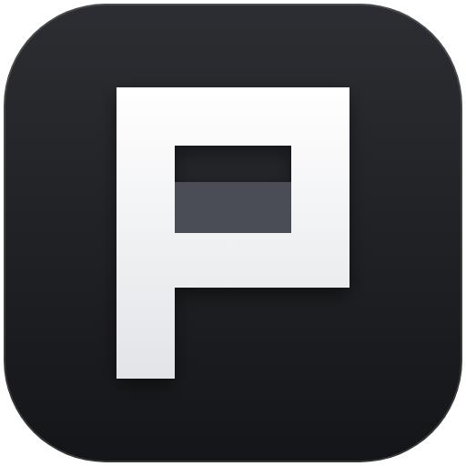

<div align="center">
  
  <h1>Pigu</h1>
  <p><strong>新一代多引擎 AI 编程桌面工作台与智能体中枢</strong></p>
  <p>
    <a href="https://github.com/AntarcticLu/pigu/releases"></a>
    <a href="https://github.com/AntarcticLu/pigu/blob/dev/LICENSE"></a>
  </p>
</div>

---

## 📦 安装与更新

### macOS（桌面端 + CLI 二合一）

在终端运行以下一行命令（自动适配 Apple Silicon `M1–M4` 与 Intel `x64`，同时安装 `/Applications/Pigu.app` 桌面端与 `pigu` 命令行）：

```bash
curl -fsSL https://raw.githubusercontent.com/AntarcticLu/pigu/dev/install | bash
```

- **启动桌面端**：在「应用程序（Applications）」中打开 **Pigu**。
- **使用命令行**：终端执行 `pigu`（若刚安装请先重启终端或运行 `exec $SHELL`）。
- **升级版本**：再次运行同一条命令即可无缝覆盖更新，配置与历史会话完整保留。

### Linux / 远程算力服务器（CLI 命令行）

在 Ubuntu / Debian / CentOS 或 AutoDL 等 Linux 服务器上运行：

```bash
curl -fsSL https://raw.githubusercontent.com/AntarcticLu/pigu/dev/install | bash
```

- 自动安装至 `~/.opencode/bin/pigu` 并写入 `$PATH`。支持本机 Pigu 桌面端通过 SSH 自动连接与拉起远端服务。

### Windows（免安装便携版）

1. 前往 [**GitHub Releases**](https://github.com/AntarcticLu/pigu/releases) 下载最新 **`pigu-windows-x64.zip`**。
2. 解压到任意文件夹，双击 **`Pigu.exe`** 即可启动桌面端（内置命令行位于 `bin\pigu.exe`）。
3. 升级时直接解压覆盖原目录即可，账号配置与历史会话独立保存在系统用户目录中。

---

## ✨ 核心特性

- **🔌 本地 CLI 零配置接管**：自动识别并加载本机已安装的 **Claude Code**、**Codex**、**DeepSeek Harness (`dsh`)**、**Antigravity (`agy`)**、**OpenCode**、**Gemini CLI**、**Cursor** 等工具的历史项目、会话与当前模型，支持在桌面端统一搜索、重命名、删除与继续对话。
- **🔄 同一会话跨引擎混排**：支持在同一对话中自由切换「云端 API 模型（如 `PiguToken`）」与「本地 CLI 引擎」，自动桥接上下文，换模型不丢记忆。
- **🐟 原生兼容 DeepSeek Harness 与大肥鱼生态**：即插即用识别 `dsh-dafeiyu` 桌面宠物伴侣与 `dsh-persona-dafeiyu` 人设插件，并支持为其自由切换任意高性价比模型。
- **🖥️ SSH 远程服务器直连**：在「设置 → 模型」中添加远程 SSH 服务器，像操作本地目录一样管理 AutoDL / Linux 远端项目并自动同步云端模型配置。
- **🧩 统一拓展中枢**：可视化管理全局与项目级 **MCP**、**Skills 技能包** 及 **本地插件**，支持中/英双语切换。

---

## 🛠️ 本地开发

```bash
bun install           # 安装依赖（需 Bun 1.3+）
bun run dev:desktop   # 启动桌面端开发环境
bun run check         # 代码与类型检查
```

## 📄 开源协议

[MIT License](./LICENSE)
